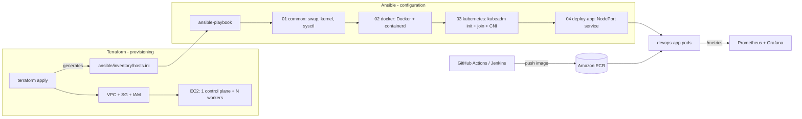
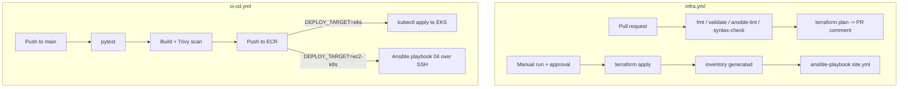

# AWS DevOps Platform: Terraform + Ansible + Docker + Kubernetes

A containerized Python service delivered through two AWS deployment paths, built to show the full **provision -> configure -> deploy -> observe** lifecycle:

| | Path A - Managed EKS | Path B - Terraform + Ansible (self-managed Kubernetes) |
|---|---|---|
| **Provision** | Terraform: VPC, EKS, ECR, GitHub OIDC role | Terraform: VPC, security group, IAM role, EC2 control plane + workers |
| **Configure** | Managed by AWS | **Ansible**: OS prep -> Docker/containerd -> kubeadm Kubernetes cluster |
| **Deploy** | CI/CD (GitHub Actions or Jenkins) | Ansible playbook (or the same CI/CD pipeline) |
| **Best for** | Production-style managed setup | Showing IaC hand-off to configuration management |

## Architecture



## Repository layout

| Path | Purpose |
|------|---------|
| `app/` | Flask service (`/`, `/health`, `/metrics`), unit tests, non-root Dockerfile |
| `terraform/bootstrap/` | One-time setup: S3 state bucket + DynamoDB lock table, GitHub OIDC provider, least-privilege `terraform` and `deploy` IAM roles |
| `terraform/eks/` | Path A: VPC, EKS, ECR (scan on push), GitHub OIDC role |
| `terraform/ec2-k8s/` | Path B: VPC, security group, ECR-read IAM role, EC2 nodes, **auto-generated Ansible inventory** |
| `ansible/playbooks/01-common.yml` | Hostname, packages, swap off, kernel modules, sysctl, time sync |
| `ansible/playbooks/02-docker.yml` | Docker Engine + containerd (systemd cgroup driver for Kubernetes) |
| `ansible/playbooks/03-kubernetes.yml` | kubeadm/kubelet/kubectl, cluster init, Flannel CNI, worker join, kubeconfig fetch |
| `ansible/playbooks/04-deploy-app.yml` | ECR pull secret, templated Deployment + NodePort Service, rollout check |
| `ansible/playbooks/05-jenkins-server.yml` | Optional Jenkins server (Docker, AWS CLI, kubectl) |
| `ansible/playbooks/site.yml` | Runs 01 -> 03 in order |
| `k8s/`, `monitoring/` | Manifests for EKS and Prometheus/Grafana (ServiceMonitor, alert rules) |
| `.github/workflows/infra.yml` | **Infra pipeline:** validate + plan on PRs; apply/destroy on demand (approval-gated) then Ansible configures the nodes |
| `.github/workflows/ci-cd.yml` | **App pipeline:** test -> build -> Trivy scan -> push to ECR -> deploy to EKS *or* to the Ansible-built cluster |
| `scripts/gen-inventory.sh` | Builds the Ansible inventory from running EC2 tags (used by the app pipeline) |
| `Jenkinsfile` | Jenkins equivalent of the app pipeline (EKS) |

Prerequisites: AWS CLI configured, Terraform >= 1.5, Ansible (`pip install ansible`), kubectl, an SSH key pair (`ssh-keygen -t rsa -b 4096` if needed).

> **Cost warning:** EC2 instances (and, for Path A, EKS + NAT gateway) bill while running. Destroy when finished.

## Remote state (S3 + DynamoDB)

All Terraform state lives in one S3 bucket with DynamoDB locking, so laptops and CI always see the same state and two people (or a person and a pipeline) can't apply at once.

| Stack | State key |
|-------|-----------|
| `terraform/bootstrap` | local (it creates the bucket, so it can't store state in it) |
| `terraform/eks` | `eks/terraform.tfstate` |
| `terraform/ec2-k8s` | `ec2-k8s/terraform.tfstate` |

**Set it up once:**
```bash
cd terraform/bootstrap
terraform init && terraform apply -var 'github_repo=<owner>/<repo>'
terraform output -raw backend_hcl > ../backend.hcl      # git-ignored; used by `make` and local runs
```
The bucket is versioned (state history / rollback), encrypted and blocks public access. Back up the small bootstrap state file, or migrate it later with `terraform init -migrate-state` after adding a backend block.

Every other stack initialises against it (the `Makefile` does this for you):
```bash
terraform init -backend-config=../backend.hcl -backend-config="key=ec2-k8s/terraform.tfstate"
```
If you already applied a stack with local state, run the same command with `-migrate-state` to move it into S3.

> Terraform 1.10+ can also lock with S3 alone (`use_lockfile`), but this project uses DynamoDB as planned.

## Path B: Terraform -> Ansible (step by step)

**1. Provision infrastructure with Terraform**
```bash
cd terraform/ec2-k8s
terraform init -backend-config=../backend.hcl -backend-config="key=ec2-k8s/terraform.tfstate"
terraform apply -var 'admin_cidr=<your-public-ip>/32'     # find it: curl ifconfig.me
```
Terraform creates the network and servers and **writes `ansible/inventory/hosts.ini`** with the new IPs.

**2. Configure the servers with Ansible** (each playbook can be run on its own)
```bash
cd ../../ansible
ansible all -m ping                                  # confirm SSH access
ansible-playbook playbooks/01-common.yml             # OS prerequisites
ansible-playbook playbooks/02-docker.yml             # Docker + containerd
ansible-playbook playbooks/03-kubernetes.yml         # kubeadm cluster
# or all three:  ansible-playbook playbooks/site.yml
```
Your admin kubeconfig lands in `ansible/kubeconfig/admin.conf`:
```bash
export KUBECONFIG=$PWD/kubeconfig/admin.conf
kubectl get nodes
```

**3. Deploy the app** (image comes from ECR; build/push it with the CI pipeline or manually)
```bash
ansible-playbook playbooks/04-deploy-app.yml \
  -e app_image=<account>.dkr.ecr.<region>.amazonaws.com/<repo>:<tag>
curl http://<worker-public-ip>:30080/health
```
Set `use_ecr: false` in `ansible/group_vars/all.yml` if the image is public.

**4. Clean up**
```bash
cd ../terraform/ec2-k8s && terraform destroy -var 'admin_cidr=<your-public-ip>/32'
```

## Path A: EKS (step by step)
```bash
cd terraform/eks
terraform init -backend-config=../backend.hcl -backend-config="key=eks/terraform.tfstate"
terraform apply     # set github_repo first
```
Add repository variables `AWS_REGION`, `AWS_ROLE_ARN` (Terraform output), `ECR_REPOSITORY` (`eks-devops-app`), `EKS_CLUSTER` (`eks-devops-cluster`), then push to `main`; the workflow tests, builds, scans, pushes to ECR and deploys.
```bash
aws eks update-kubeconfig --region us-east-1 --name eks-devops-cluster
kubectl apply -f https://github.com/kubernetes-sigs/metrics-server/releases/latest/download/components.yaml   # for the HPA
helm repo add prometheus-community https://prometheus-community.github.io/helm-charts
helm install kube-prometheus-stack prometheus-community/kube-prometheus-stack -n monitoring --create-namespace -f monitoring/prometheus-values.yaml
kubectl apply -f monitoring/servicemonitor.yaml -f monitoring/alert-rules.yaml
```
Cleanup: `kubectl delete -f k8s/`, `helm uninstall kube-prometheus-stack -n monitoring`, then `cd terraform/eks && terraform destroy` (delete the Service first so its load balancer doesn't block VPC deletion).


## CI/CD automation

Two pipelines automate everything above, authenticating to AWS with **GitHub OIDC** (no stored access keys).



### One-time setup
1. **Bootstrap** (see *Remote state* above): creates the state bucket, lock table, OIDC provider and the CI roles. If your account already has the GitHub OIDC provider, import it or remove that resource first. When using bootstrap together with `terraform/eks`, set `create_oidc_provider=false` there.
2. **Repository variables** (Settings -> Secrets and variables -> Actions -> Variables):

   | Variable | Value |
   |----------|-------|
   | `AWS_REGION` | e.g. `us-east-1` |
   | `TF_ROLE_ARN` | bootstrap output `terraform_role_arn` |
   | `TF_STATE_BUCKET` / `TF_LOCK_TABLE` | bootstrap outputs |
   | `ADMIN_CIDR` | your public IP, e.g. `203.0.113.10/32` |
   | `AWS_ROLE_ARN` | Path B: bootstrap output `deploy_role_arn` - Path A: EKS stack output `github_actions_role_arn` |
   | `ECR_REPOSITORY` | Path B: `k8s-ansible-app` - Path A: `eks-devops-app` |
   | `DEPLOY_TARGET` | `ec2-k8s` or `eks` (leave unset to build/push only) |
   | `EKS_CLUSTER` | Path A only: `eks-devops-cluster` |

3. **Repository secrets:** `SSH_PUBLIC_KEY` and `SSH_PRIVATE_KEY` (the key pair Terraform installs on the nodes and Ansible uses).
4. **Environment:** create a GitHub Environment named `production` and add required reviewers - apply/destroy waits for approval.

### Day-to-day flow
- **Change infrastructure or playbooks:** open a PR -> checks run and the Terraform plan is posted as a comment -> merge.
- **Create the environment:** Actions -> *Infrastructure (Terraform + Ansible)* -> Run workflow -> `apply` -> approve. It provisions with Terraform, then runs Ansible (`site.yml`) to build the cluster.
- **Ship the app:** push to `main` -> tests, image build and scan, push to ECR, deploy. A push that changes the app deploys it automatically.
- **Stop the bill:** run the infra workflow with `destroy`.

### How SSH access is handled safely
The security group only allows SSH from `ADMIN_CIDR`. Each pipeline run opens port 22 for **that runner's IP only**, does its work, then removes the rule (`if: always()`), so nothing stays exposed.

### Known limitations (worth stating in an interview)
- The Terraform role uses `AdministratorAccess` for simplicity - scope it down for production.
- The bootstrap stack's own state is local; keep that small file safe (or migrate it to S3 after creation).
- Self-hosted runners or SSM Session Manager would remove the need for SSH rules entirely.

## Run locally
```bash
make test && make run          # http://localhost:8080
docker build -t devops-app:local app/ && docker run -p 8080:8080 devops-app:local
```

## Design notes
- **Clear separation of concerns:** Terraform owns cloud resources; Ansible owns what runs *on* the servers. The generated inventory is the hand-off.
- **Idempotent playbooks:** `creates:` guards, state-checking tasks and handlers make re-runs safe.
- **Least exposure:** SSH and the Kubernetes API are limited to `admin_cidr`; nodes use an IAM role limited to ECR read access.
- **Security scanning in CI:** Trivy fails the build on fixable CRITICAL findings; ECR scans on push; images are tagged with the commit SHA.
- **Keyless CI auth (Path A):** GitHub Actions uses OIDC instead of stored AWS keys.

## Possible extensions
Ansible roles + Molecule tests, Terraform remote state (S3 + DynamoDB), Ingress + TLS, Argo CD for GitOps, Helm chart for the app, HA control plane.
